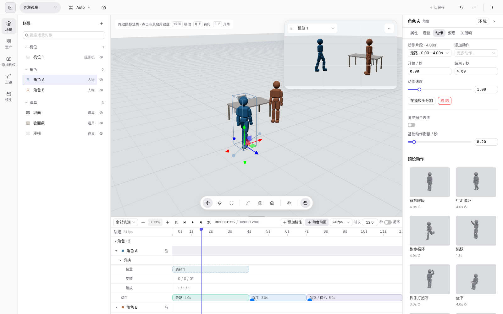
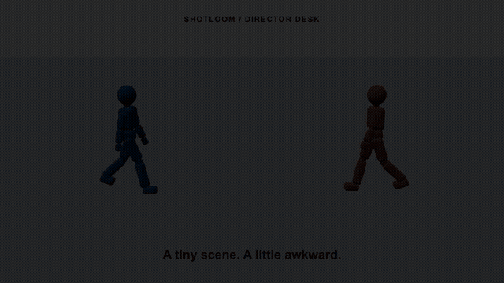
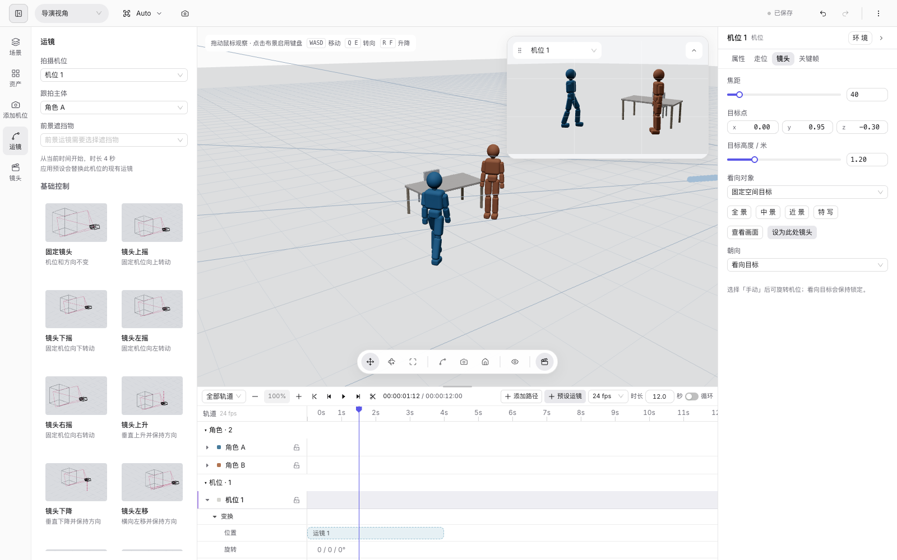
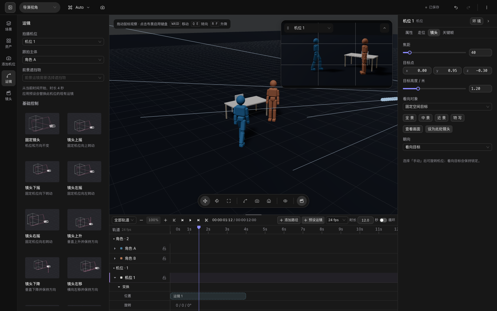

# Shotloom Director Desk

A 3D previsualization workbench. Stage a set, block character motion, design camera moves, and export visual references for video generation.

[简体中文](README.md) · **English**



## A tiny scene in twelve seconds

Two characters meet, wave, and jump together. Character actions, three cameras and an orbit turn a simple encounter into a short previz scene. This animation comes from a video exported by the workbench.

[](docs/images/shotloom-demo.mp4)

[Watch / download the HD MP4](docs/images/shotloom-demo.mp4) · 12 seconds · 1280 × 720 · 24 fps

## Workflow

1. **Stage** — add characters, furniture, buildings and props from the asset panel, or import GLB / glTF / FBX / OBJ.
2. **Block** — add action clips and motion paths, then adjust timing, speed and transitions on the timeline.
3. **Place cameras** — choose a composition preset, then select a camera move, subject and foreground object.
4. **Review** — inspect spatial relationships in the director view, check framing in the floating camera monitor, or switch to the camera view.
5. **Export** — render PNG or MP4 / WebM using the cut sequence, a selected camera, or separate files for each shot.

## Camera moves and composition

Interactive wireframe previews show locked shots, pans, tilts, rises, trucks, dollies, tracking and orbits. Moves begin at the camera's current position. Tracking and orbit moves can follow a moving subject; foreground moves require an actual foreground object. Zoom and dolly zoom control focal length and camera distance separately.



## Workbench features

| Workflow       | Tools                                                                                                        |
| -------------- | ------------------------------------------------------------------------------------------------------------ |
| Staging        | Procedural characters and props, color, dimensions, grid snapping, surface placement and model import        |
| Performance    | Built-in actions, joint poses, motion paths, clips, speed and transitions                                    |
| Cinematography | Multiple cameras, composition presets, focal length, camera paths, position and rotation keys                |
| Timeline       | Playback, frame stepping, split, trim, zoom, grouped tracks and cuts                                         |
| Review         | Framing guides, previous-shot overlays, overlap / out-of-frame / intersection checks                         |
| Delivery       | PNG, MP4 / WebM, single-shot and batch export, shot list                                                     |
| Workspace      | Light and dark themes, resizable panels, collapsible timeline, floating camera monitor and recovery autosave |



The default character is generated from original code and basic geometry. Poses and animation drive the same joints without an external character model file.

## Controls

- Drag to orbit and scroll to zoom. Focus the stage, then use `WASD` to move, `Q/E` to turn, and `R/F` to rise or fall.
- `Space` toggles playback; `1/2/3` select move / rotate / scale; `Delete` removes the selected object or clip; `/` searches.
- Draw paths on the ground or object surfaces. `Enter` finishes and `Esc` cancels; freehand paths are also supported.
- Drag timeline clips to move them and their right handles to trim. The action panel can split a clip at the playhead.
- The clapperboard button toggles the timeline. The top-right menu contains project settings, theme switching and project reset.

Edits are backed up automatically and can be recovered on reopening. Project settings control aspect ratio and frame rate. When embedded in Shotloom, the workbench can receive upstream reference images and communicate with the director assistant through its host bridge.

Live phone camera control and depth-of-field rack focus are currently unavailable. The standalone page has no reference-background upload control.

## Development and validation

```bash
npm ci
npm run dev          # http://127.0.0.1:5173
npm run build        # theme generation, typecheck, production build and privacy check
npm run typecheck
npm run test:assets  # download and verify pinned external model fixtures first
npm test
npm run smoke        # requires the dev server and Google Chrome
```

Additional browser checks: `node scripts/smoke-depth.mjs` and `node scripts/smoke-timeline.mjs`. Set `DIRECTOR_URL` to use another development server address.

Regenerate the README media:

```bash
node scripts/screenshots.mjs  # three workspace screenshots
node scripts/demo-video.mjs   # actual video export, MP4 and GIF; requires ffmpeg
```

The media scripts create their own demonstration scene. The UI uses React 19 + Ant Design 6 and the 3D engine uses Three.js. Theme variables originate in `src/shared/styles/theme-tokens.ts`; run `npm run theme:generate` to regenerate theme CSS. Prettier manages formatting through `npm run format` / `npm run format:check`.

## License

[MIT](LICENSE)
