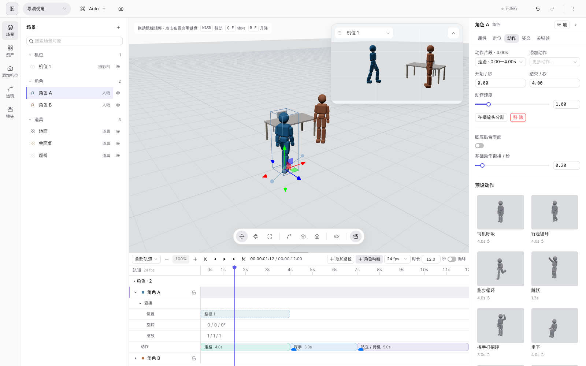
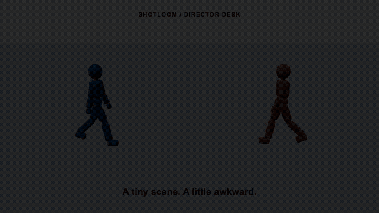
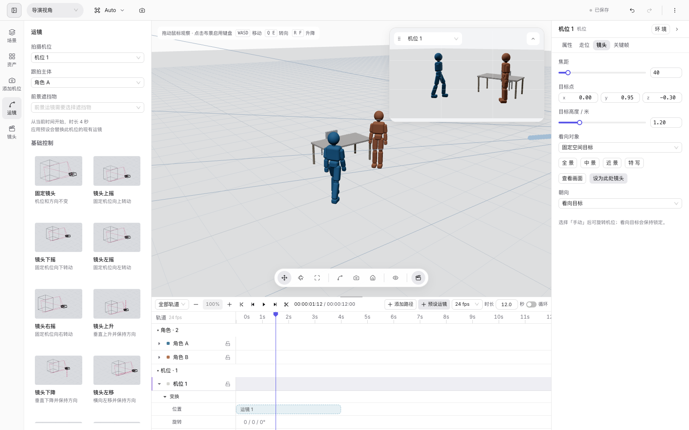
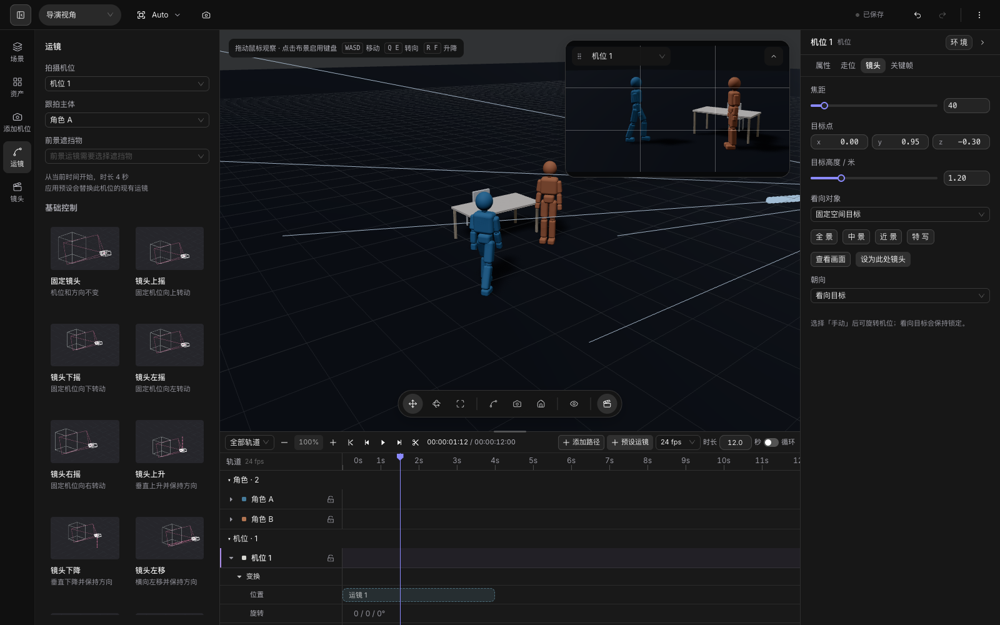

# Shotloom Director Desk

三维场景预演工作台。搭布景、排人物走位、设计运镜，再导出给视频生成模型使用的参考画面。

**简体中文** · [English](README.en.md)



## 十二秒，拍一场小戏

两个人相遇、挥手，然后一起跳起来。用人物动作、三个机位和一段环绕运镜，完成一场简单的预演。下面的动画来自导演台实际导出的视频。

[](docs/images/shotloom-demo.mp4)

[观看 / 下载高清 MP4](docs/images/shotloom-demo.mp4) · 12 秒 · 1280 × 720 · 24 fps

## 从一场戏开始

1. **搭场景**：左侧「资产」添加人物、家具、建筑与道具，也可以导入 GLB / glTF / FBX / OBJ 模型。
2. **排表演**：为人物添加动作片段和走位路径，在时间线上调整起止、速度与衔接。
3. **放机位**：从「添加机位」选择构图预设，再在「运镜」里选择移动方式、跟拍主体与前景遮挡物。
4. **看成片**：在导演视角检查空间关系，通过浮动画中画查看机位构图，或切换到机位视角。
5. **导出参考**：输出 PNG 或 MP4 / WebM，可按切镜、指定机位或每个镜头分别导出。

## 运镜与构图

运镜面板提供可交互的线框预览：固定、摇镜、升降、横移、推拉、跟拍与环绕等。预设从机位当前位置生成路径；跟拍和环绕可关联运动中的主体，前景运镜需要真实遮挡物。焦距变焦与推拉变焦分别控制镜头参数和机位距离。



## 工作台功能

| 工作环节 | 可用功能                                                     |
| -------- | ------------------------------------------------------------ |
| 布景     | 白模人物与道具、颜色与尺寸、网格吸附、表面落点、外部模型导入 |
| 表演     | 内置动作、关节姿态、走位路径、动作片段、速度与过渡           |
| 摄影     | 多机位、构图预设、焦距、运镜路径、位置与旋转关键帧           |
| 时间线   | 播放、逐帧、分割、修剪、缩放、分组轨道与切镜                 |
| 检查     | 构图辅助线、上一镜叠加、人物重叠 / 出画 / 穿模检查           |
| 交付     | PNG、MP4 / WebM、单镜或批量导出、镜头清单                    |
| 工作区   | 深浅主题、可调面板、可折叠时间线、浮动机位预览、自动备份恢复 |



默认人物由项目代码与基础几何体生成，姿态和动作驱动同一套关节，不依赖外部人物模型文件。

## 操作提示

- 视口拖动旋转、滚轮缩放；点击布景后用 `WASD` 移动视角，`Q/E` 转向，`R/F` 升降。
- `Space` 播放 / 暂停，`1/2/3` 切换移动 / 旋转 / 缩放，`Delete` 删除选中对象或片段，`/` 搜索。
- 添加路径后在地面或物体表面落点，`Enter` 完成，`Esc` 取消；也支持手绘路径。
- 时间线拖动片段调整位置，拖右侧手柄调整时长；动作面板支持在播放头分割。
- 底部场记板按钮展开 / 收起时间线；右上角「更多」提供项目设置、主题切换和重置项目。

编辑会自动备份，重新打开后可恢复。画幅与帧率在「项目设置」中调整。嵌入 Shotloom 时，可接收上游图片节点作为参考背景，并通过宿主通信接口与导演助手交互。

当前不支持手机实时虚拟摄像机或景深拉焦；独立页面没有参考背景上传入口。

## 开发与验证

```bash
npm ci
npm run dev          # http://127.0.0.1:5173
npm run build        # 主题生成、类型检查、生产构建与发布隐私检查
npm run typecheck
npm run test:assets  # 首次下载并校验固定版本的外部测试模型
npm test
npm run smoke        # 需要开发服务器与 Google Chrome
```

补充浏览器检查：`node scripts/smoke-depth.mjs`、`node scripts/smoke-timeline.mjs`。通过 `DIRECTOR_URL` 指定开发服务器地址。

更新本页媒体：

```bash
node scripts/screenshots.mjs  # 重新拍摄三张工作区截图
node scripts/demo-video.mjs   # 实际导出视频，生成 MP4 与 GIF；需要 ffmpeg
```

截图与视频使用脚本创建的演示场景。界面为 React 19 + Ant Design 6，三维引擎基于 Three.js。`src/shared/styles/theme-tokens.ts` 是主题变量来源，`npm run theme:generate` 生成主题 CSS。代码格式由 Prettier 管理：`npm run format` / `npm run format:check`。

## License

[MIT](LICENSE)
